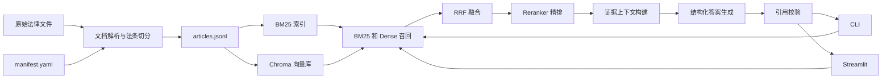
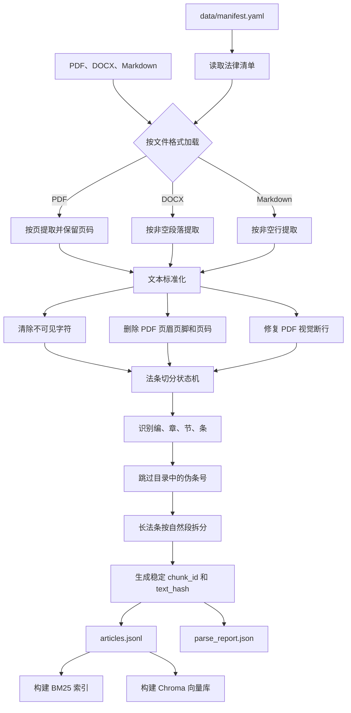
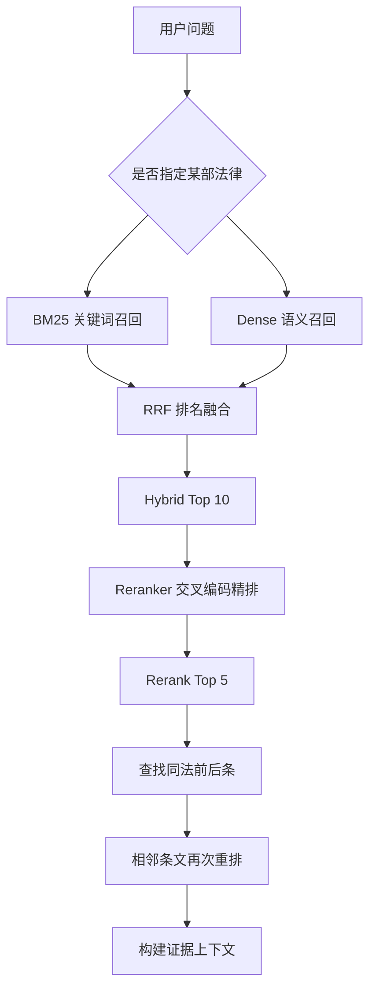
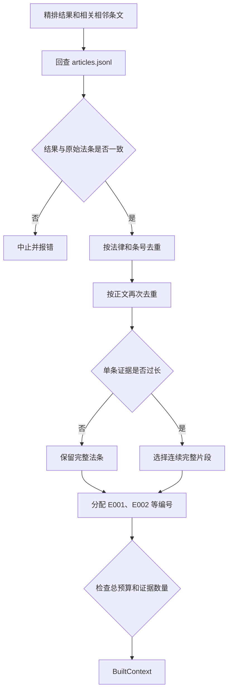
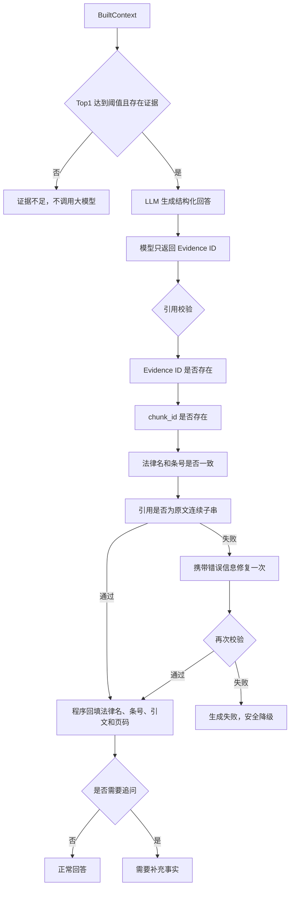
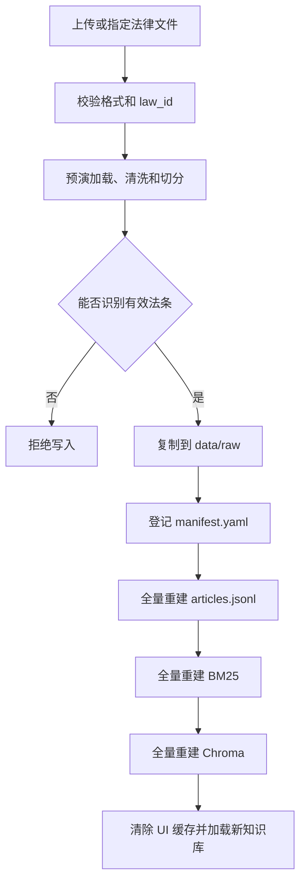
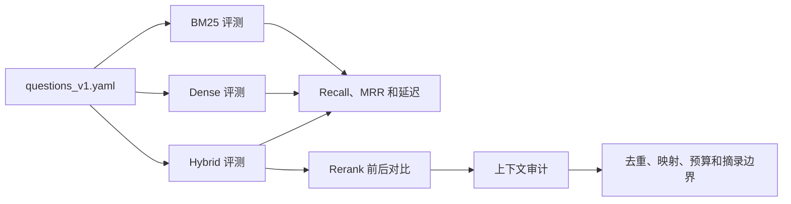

# rag_law：可追溯的法律 RAG 问答系统

面向 15 部中华人民共和国法律构建的本地知识库问答系统。用户用自然语言描述问题后，系统通过混合检索、Reranker 精排和结构化生成给出回答，并将每一条引用回查到原始法条；证据不足时主动拒答，避免模型编造法律依据。

> 本项目用于法律信息检索与技术研究，不构成法律意见。

## 项目概览

| 项目 | 当前数据 |
|---|---:|
| 收录法律 | 15 部 |
| 结构化法条 | 2879 条 |
| 原始格式 | PDF、DOCX、Markdown |
| 评测集 | 30 题，其中 24 题可回答、6 题拒答或追问 |
| Hybrid Recall@10 | 0.9792 |
| Hybrid MRR | 0.7653 |
| 自动化测试 | 113 项通过 |

核心技术栈：Python、LangChain、Chroma、BM25、jieba、OpenAI 兼容 API、Pydantic、Streamlit、PyMuPDF、python-docx。

## 项目解决了什么问题

通用大模型直接回答法律问题时，主要存在三类风险：

- 法律名称、条号或内容可能被模型编造；
- 长文档直接放入 Prompt，成本高且难以定位依据；
- 即使模型给出引用，也无法确认引用是否来自本次检索到的原文。

本项目的解决思路是：

1. 把不同格式的法律文件统一切分为带来源信息的法条；
2. 使用 BM25 和向量检索同时召回，兼顾关键词与语义；
3. 使用 Reranker 精排，并补充相关的相邻条文；
4. 只让模型选择系统分配的 Evidence ID；
5. 程序将 Evidence ID 回查到原始法条，校验通过后才允许展示。

## 系统架构



## 核心实现链路

### 1. 法律文件入库



这一阶段的关键设计是保留 `law_id`、法律名称、编章节、条号、页码和原始文件路径，使检索结果可以回溯到原始文档。

### 2. 用户问题检索与精排



检索层使用两条互补路线：

- BM25 擅长条号、法律术语和关键词精确匹配；
- Dense 擅长用户口语与法律表达之间的语义匹配；
- RRF 只融合排名，不直接相加两种尺度不同的分数；
- Reranker 同时看到法律名、编章节、条号和正文，进行更精细的相关性判断。

当前默认参数：Hybrid 候选 10 条、BM25/Dense 权重 `1:2`、Rerank 保留 5 条。

### 3. 上下文构建



上下文默认最多 6 条证据、总预算 3000 个保守估算 Token、单条证据不超过 700。超长法条不会从句子中间硬切，而是选择相关性最高的连续完整片段。

### 4. 回答生成与引用校验



这里最重要的原则是：模型不直接生成最终引用，而是只选择证据编号；最终引用由程序从原始法条回填。即使结构化输出格式正确，只要引用无法映射到原文，也不会向用户展示。

## 回答状态

| 状态 | 触发条件 | 处理方式 |
|---|---|---|
| `answered` | 有充分证据、引用校验通过 | 展示分析和已校验引用 |
| `needs_clarification` | 缺少主体、时间、行为性质等关键事实 | 展示一个最重要的追问 |
| `insufficient_evidence` | 相关度过低或没有有效引用 | 不生成或不展示法律结论 |
| `generation_failed` | 结构化生成失败或二次引用校验仍失败 | 返回固定安全文案 |

## 添加新法律的重建链路



新增法律不是简单复制文件，而是完成语料、稀疏索引和向量索引的一致性重建。同一条目可以安全重试；同名但内容不同的文件会被拒绝覆盖。

## 核心模块

| 模块 | 职责 |
|---|---|
| `ingestion/loaders.py` | 统一加载 PDF、DOCX、Markdown |
| `ingestion/normalizer.py` | 字符清洗、PDF 页边删除和断行修复 |
| `ingestion/article_splitter.py` | 识别法律层级并切分法条 |
| `ingestion/pipeline.py` | 串联处理并原子写出结构化语料 |
| `retrieval/bm25.py` | jieba 分词和 BM25 关键词检索 |
| `retrieval/dense.py` | Embedding 与 Chroma 语义检索 |
| `retrieval/fusion.py` | 加权 RRF 混合检索 |
| `retrieval/reranker.py` | 远程 Cross-Encoder 精排 |
| `retrieval/context_builder.py` | 邻条补充、去重、摘录、预算和 Evidence 编号 |
| `generation/answer_pipeline.py` | 证据门控、生成、修复与安全降级 |
| `generation/citation_validator.py` | 将模型引用严格映射回原始法条 |
| `generation/run_logger.py` | 回答运行日志与敏感信息脱敏 |
| `knowledge_base.py` | 添加法律并重建全链产物 |
| `cli.py` / `ui/app.py` | 命令行与 Streamlit 应用入口 |

## 项目中的关键设计取舍

### 为什么使用 BM25 + Dense

单独使用 BM25 容易漏掉口语化表达，单独使用 Dense 又可能在条号和专有名词上不稳定。两路召回后用 RRF 融合，既保留关键词检索的确定性，也利用向量检索的语义能力。

### 为什么还要使用 Reranker

向量模型负责从近三千条法条中快速召回候选，Reranker 只比较少量候选与问题，可以用更高成本获得更准确的排序，避免直接对全库做交叉编码。

### 为什么不让模型直接输出法律名和原文

大模型复制长文本时可能产生一个字的偏差，也可能生成不存在的条号。使用短 Evidence ID 后，模型只负责“选择哪条证据”，法律名、条号和引文由程序回填，从设计上降低引用幻觉。

### 为什么只修复一次

无限重试会导致成本、时延不可控。项目允许引用失败后修复一次，仍失败就安全降级，在准确性、成本和用户等待时间之间做明确约束。

### 如何保证语料和索引一致

- 解析全部成功后才原子替换正式 JSONL；
- Chroma 加载时校验索引 ID 集合与 `articles.jsonl` 完全一致；
- 检索结果进入上下文前再次与原始法条核对；
- 引用展示前再完成一次 Evidence → Chunk → 原文校验。

## 评测与质量保障



测试覆盖 Loader、清洗、切分、索引持久化、融合、精排、上下文预算、引用校验、安全降级、脱敏日志、CLI 和 Streamlit 页面。目前自动化测试结果为 `113 passed`。

## 快速开始

### 1. 安装与配置

```powershell
uv sync
Copy-Item .env.example .env
```

在 `.env` 中配置 LLM、Embedding 和 Reranker 的 OpenAI 兼容服务地址、API Key 与模型名称。

### 2. 初始化数据和索引

```powershell
uv run python scripts/check_manifest.py
uv run python scripts/verify_env.py
uv run python -m rag_law.ingestion.pipeline
uv run python -m rag_law.retrieval.bm25 --build
uv run python -m rag_law.retrieval.dense --build
```

### 3. 运行

```powershell
# 完整问答
uv run python -m rag_law.cli answer --query "公司一直没有和我签书面劳动合同，可以要求赔偿吗？"

# 查看召回、精排和上下文中间结果
uv run python -m rag_law.cli context --query "公司一直没有和我签书面劳动合同，可以要求赔偿吗？"

# 启动 Streamlit
uv run streamlit run src/rag_law/ui/app.py

# 运行测试
uv run pytest -q
```

## 面试介绍参考

### 一分钟版本

这是一个面向中国法律文本的 RAG 问答项目。我首先把 PDF、DOCX 和 Markdown 法律文件统一清洗并按法条切分，目前知识库包含 15 部法律、2879 条法条。检索层采用 BM25 和 Chroma 向量检索双路召回，再通过加权 RRF 融合和 Reranker 精排。为了降低法律引用幻觉，我没有让大模型直接生成法律名称和条文，而是给每段上下文分配 Evidence ID；模型只选择 Evidence ID，程序再回查原始法条，校验法律名、条号和原文片段。证据不足时系统不会调用模型，引用校验失败只修复一次，仍失败就安全降级。目前 Hybrid Recall@10 达到 0.9792，并有 113 项自动化测试覆盖主要链路。

### 面试中可以重点展开的四点

1. **文档处理**：如何处理 PDF 页眉页脚、视觉断行、目录伪条号和跨页法条；
2. **检索设计**：为什么选择 BM25 + Dense + RRF + Reranker，而不是只做向量检索；
3. **可信引用**：Evidence ID、原文回查、连续子串校验和安全降级如何控制幻觉；
4. **工程完整性**：原子写入、索引一致性、脱敏日志、可重试知识库重建和量化评测。

## 已知限制

- `0.15` 的回答阈值来自当前小型评测集，仍需使用独立数据重新校准；
- 显式提到知识库外法律时，当前主要依赖相关度和模型判断，后续应增加法律名称范围识别；
- Token 数目前使用非空白字符进行保守估算，不是模型的真实 tokenizer；
- 添加法律会全量重建向量索引，语料继续增长后需要增量更新；
- Streamlit 历史只用于展示，当前不是带历史上下文的多轮问答；
- `api/main.py` 和回答层自动评测仍待实现。

更详细的阶段设计和实验记录见 `docs/plan/v1/` 与 `docs/note/v1/`。
